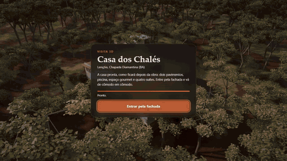
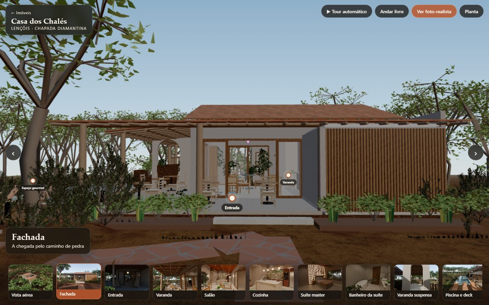
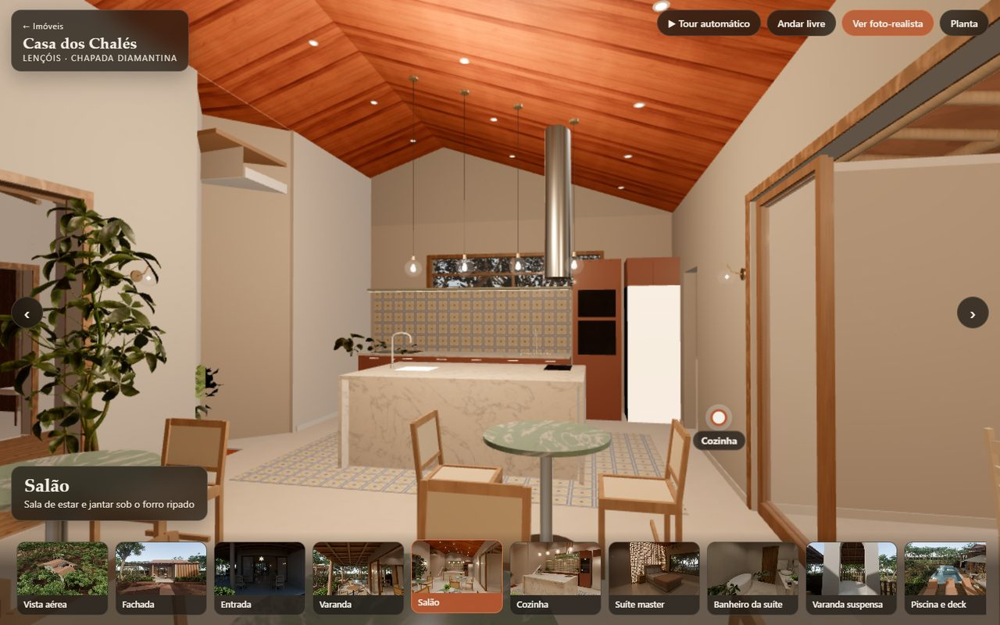
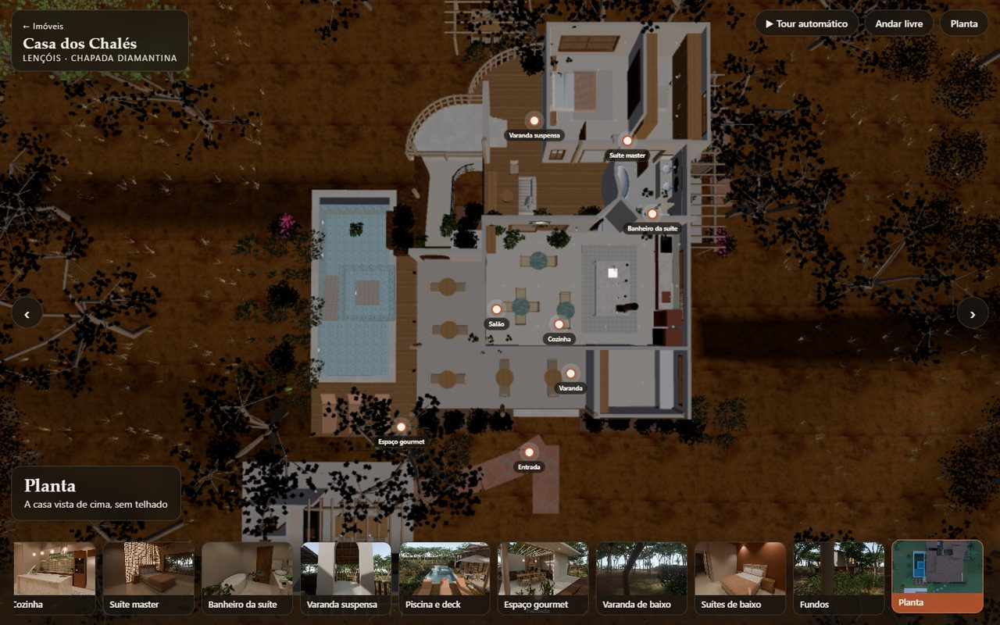
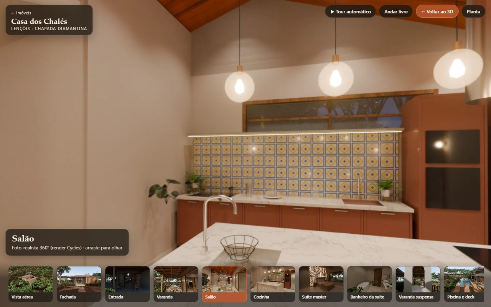
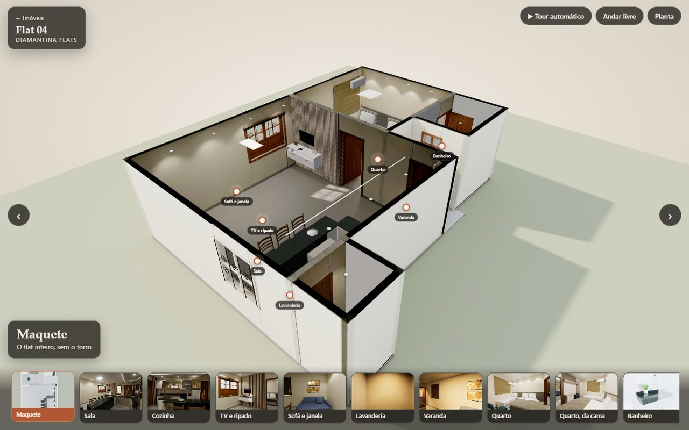
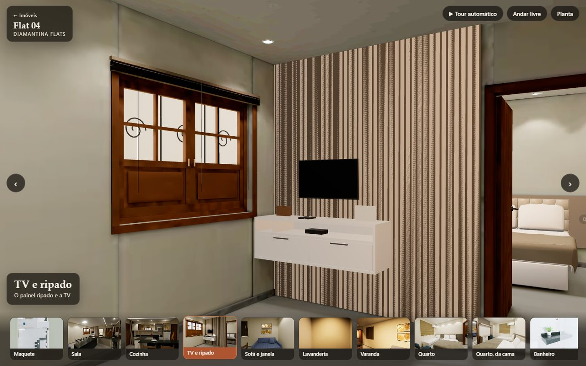

# site-3d: imóveis reais em 3D, navegáveis no navegador

Visitas 3D da **Casa dos Chalés** (Lençóis, Chapada Diamantina) e do **Flat 04** (Diamantina Flats). Os modelos foram feitos no Blender a partir das plantas e das fotos, e o navegador mostra tudo com three.js. A câmera leva o visitante de cômodo em cômodo como num filme; ele também pode andar livre ou abrir a foto 360° renderizada no Cycles.



| | |
|---|---|
|  |  |
|  |  |
|  |  |

Vídeos: [tour cinematográfico da casa](docs/midia/cinema-casa.mp4) · [do flat](docs/midia/cinema-flat.mp4) · [passeio guiado](docs/midia/passeio-casa.mp4)

## O que dá para fazer

- **Entrada pela fachada:** um render do Cycles cobre a tela enquanto o modelo carrega (com a barra de progresso). Depois a câmera desce da vista aérea até a porta.
- **Câmera de cinema em cada parada:** dolly de entrada, panorâmica lenta, movimento lateral com parallax, grua e órbita (GSAP), sempre conferindo a colisão para não entrar na parede. Para ir de um cômodo a outro que não se enxergam, a câmera sobe por cima do telhado: forro e telhado somem, como numa maquete.
- **Navegação:** marcas na cena (só aparecem quando o olho enxerga o lugar), menu de cômodos com miniaturas, setas, teclado, roda do mouse, tour automático com cortes suaves e a planta vista de cima.
- **Andar livre:** WASD, mouse travado e Shift para correr; no celular, joystick de toque. A colisão cobre paredes, pisos, escadas e terreno. As portas fechadas abrem sozinhas quando o visitante chega perto.
- **Foto-realista 360°:** panoramas do Cycles, que abrem em 4K na hora e passam a 8K no desktop.
- **Celular:** layout próprio, sem a mata, com resolução adaptativa.

## Como rodar

```bash
npm install
npm start          # build + abre http://127.0.0.1:4173/
```

Para desenvolver, use `npm run dev`. Link direto para uma parada: `casa.html#cozinha`.

## Como foi feito

- **Modelos:** o `construir.py` do repositório flats-3d monta cada imóvel no Blender pela linha de comando e exporta o GLB. Depois vem o glTF-Transform: meshopt, WebP e `--join false`, que mantém os nomes das malhas (o site acha forro, telhado e portas pelo nome). A casa cai de 18,4 MB para 2,4 MB. A mata vai num GLB à parte, de 11 MB, carregado depois da casa. Os modelos-fonte (Blender) ficam num repositório privado: os scripts de `pipeline/` são só referência de como os GLB foram gerados.
- **Luz:**
  - o sol vem com a direção e a cor do Cycles, com sombra (as folhas recortam a sombra pelo alfa);
  - o ambiente (IBL) sai do panorama Cycles do cômodo mais perto;
  - luzes quentes acendem nos cômodos perto do visitante;
  - o contraste imita o look AgX do Blender;
  - no flat, paredes, piso e teto têm luz assada no Cycles (lightmap na segunda UV).
- **Desempenho:**
  - na carga, as malhas paradas do mesmo material viram uma só: a casa cai de cerca de 1.270 para menos de 300 chamadas de desenho, sem mudar o modelo;
  - os shaders compilam antes da entrada;
  - a sombra só é refeita quando a cena muda;
  - se o quadro passa de 40 ms, o site desce três degraus: primeiro a resolução, depois a sombra e por último a mata.
- **Dream-loop:** o método do vídeo "I Built This 3D Site in Claude Code Without Writing Three.js" (DesignCode), com a skill [dream-loop](https://github.com/achimala/dream-loop). Cada rodada captura o site da mesma câmera que o render Cycles, e um juiz novo dá a nota. A casa passou de 3,4 para 5,0 de 10; o histórico está em `docs/dream-loop/`. A pesquisa está em `docs/pesquisa/`.

Stack: Vite 8, three.js 0.187, GSAP, Playwright e glTF-Transform. Não há framework de interface.

## Testes

```bash
npm run build
node testes/testar.mjs    # desktop e celular, as duas páginas: FPS, erros de console, cada parada, andar livre, 360°
node testes/portas.mjs    # anda de verdade por 14 passagens e confere que nenhuma porta trava
```

O teste usa o Edge instalado. `--gpu alta` força a GPU dedicada.

## Limites conhecidos

- **Ainda não foram para o GLB:** as copas densas e o capim, que no Blender são partículas, e a decoração dos renders.
- **A luz assada da casa** ainda não foi feita.
- **No flat 04**, o modelo usado é o atual. A sala deve ser refeita quando chegarem as medidas.

## Licenças

O código é MIT. Modelos, renders e panoramas dos imóveis: todos os direitos reservados. Ver [LICENCAS.md](LICENCAS.md).
