# Dream-loop no site 3D (03/11/2026)

O método do vídeo da DesignCode, com a skill [dream-loop](https://github.com/achimala/dream-loop) no fluxo **Pro**: o alvo é uma imagem da vista pronta; o site é capturado da mesma câmera; um **juiz novo a cada rodada** (subagente sem memória) compara o lado a lado e dá nota pela rubrica da skill (composição 0–3, luz 0–3, materiais 0–3, detalhes 0–1); as correções saem da lista do juiz.

Como aplicamos, sem gasto e sem remodelar:
- **O alvo é o render Cycles que já existia** em `flats-3d/saida/` (a skill aceita alvo fornecido pelo usuário). Não geramos imagem.
- A captura sai de `testes/capturar.mjs`, com o site em `?limpo#<parada>` no tamanho do render.
- **Só mudamos câmera, luz, pós e parâmetros de material.** Mata, paisagismo e decoração não vão no GLB do site e ficaram como "fora do escopo".

## Notas (de 0 a 10)

| Vista | r1 (luz original) | r5 | r7 (final; juízes rodando às 22h20) |
|---|---|---|---|
| casa: fachada | 3,10 | 4,15 | em medição |
| casa: salão | 3,95 | 5,00 | em medição |
| casa: cozinha | 4,45 | 5,00 | em medição |
| casa: piscina | 3,00 | 4,65 | em medição |
| casa: suíte | 2,60 | 3,80 | em medição |
| casa: gourmet | sem nota (o juiz da r1 não terminou) | 5,00 | em medição |
| flat: sala | 2,70 | 3,95 | em medição |
| flat: cozinha | 3,40 | 3,85 | em medição |
| flat: TV | 3,10 | 3,90 | em medição |
| flat: banheiro | 3,20 | 2,35 | em medição |

Nas nove vistas com nota nas duas rodadas, a média foi de **3,3 (r1) para 4,1 (r5)**. A r7 entrou depois de mais correções dos juízes da r5.

Os renders do flat são de 20/10, anteriores à ampliação de 12% de 21/10. Por isso o enquadramento do flat não bate, e os juízes foram avisados de que a câmera não deve ser mexida para compensar.

## O que cada rodada mudou

- **r1 → r4:**
  - o sol na direção e na cor do `luz.sol` do Cycles, com sombra (desktop);
  - menos preenchimento branco de estúdio;
  - luzes quentes nos cômodos perto do visitante;
  - a lente de cada câmera Cycles.
- **r4 → r5:**
  - o **ambiente (IBL) tirado do panorama Cycles do próprio cômodo**, o "light probe" do vídeo: reflexos e preenchimento com a cor da madeira e das paredes;
  - exposição por parada;
  - a folha de porta aberta escondida na vista da suíte;
  - o sheen dos tecidos sem branco, filtragem anisotrópica e LEDs mais vivos.
- **r5 → r7**, pedidos dos juízes:
  - o vidro deixa de projetar sombra (barrava o sol nas janelas);
  - o sol em cor linear (estava laranja);
  - as luzes dos cômodos apagadas nas vistas de fora;
  - o céu frio mais fraco dentro de casa;
  - o contraste do look "AgX Medium High Contrast";
  - a terra vermelha (laterita) no terreno;
  - o ripado sem z-fighting.

## Lado a lado (esquerda alvo Cycles, direita site ao vivo)

| Rodada 1 | Rodada 7 |
|---|---|
| 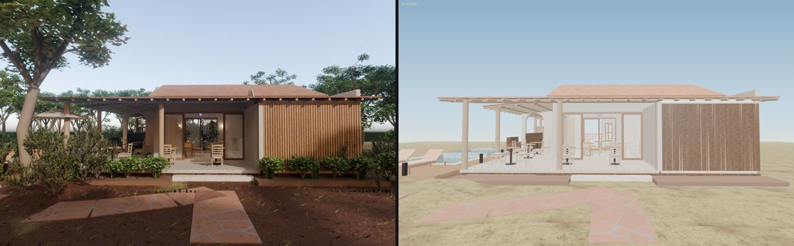 | 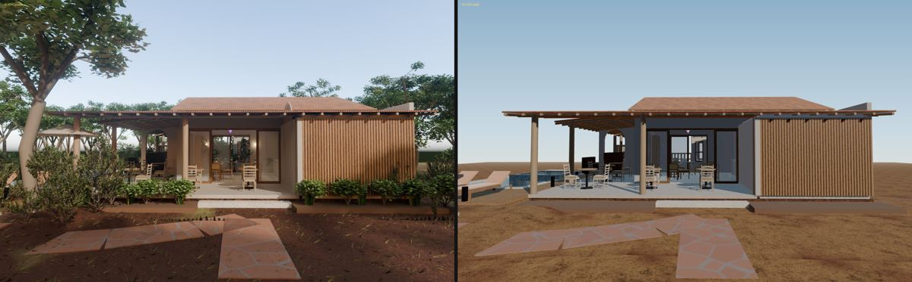 |
| 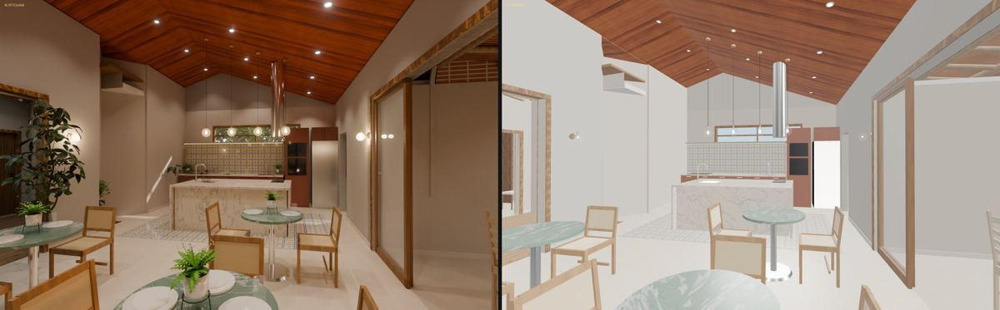 | 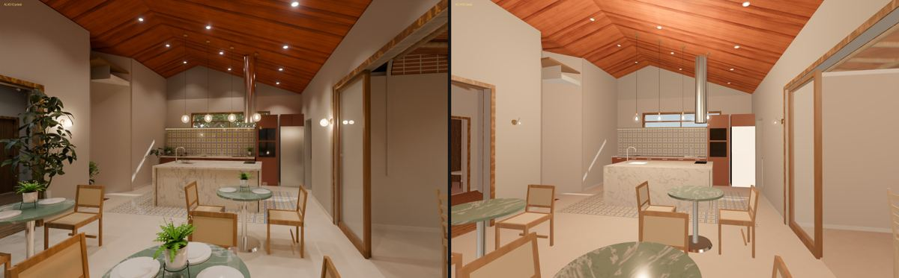 |
| 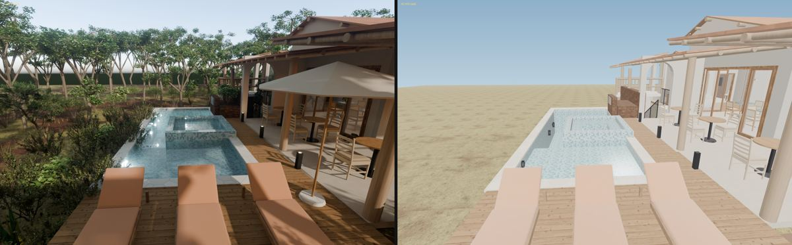 | 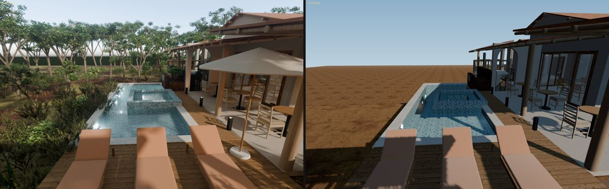 |
| 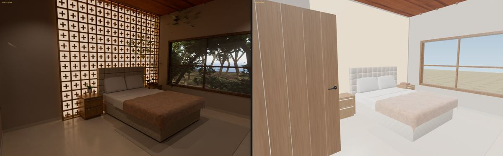 | 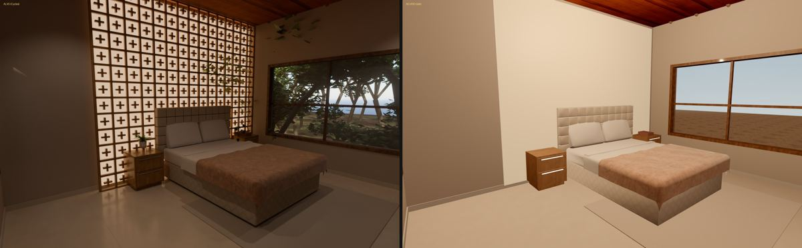 |
| 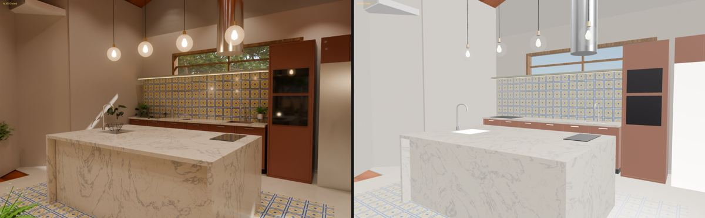 | 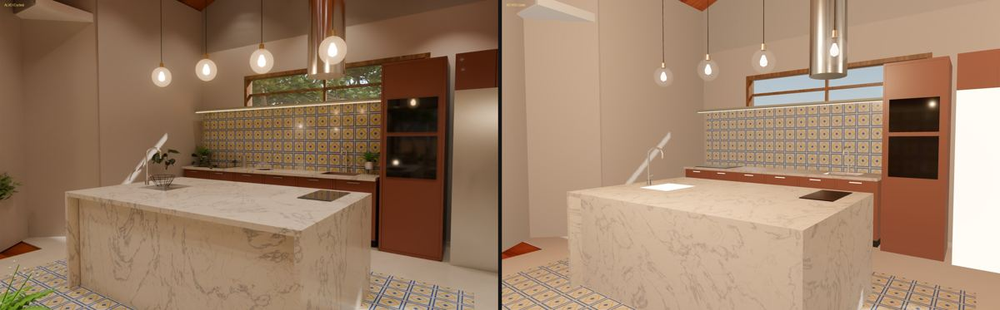 |
| 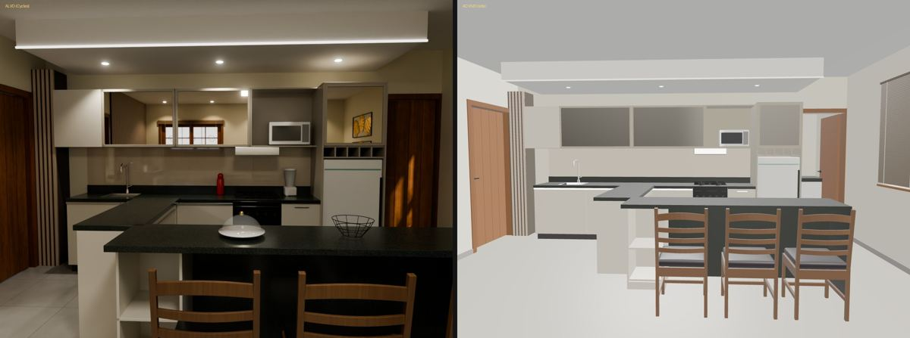 | 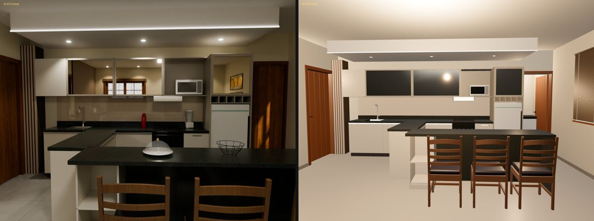 |

## Por que não chega a 8 (a regra de parada da skill)

Pela regra de "travar", o juiz repete as mesmas lacunas de rodada em rodada, e todas são de **arquitetura**, fora do que se ajusta com luz:
1. **A mata, o paisagismo e a decoração** (plantas, louça, cobogó vazado) não vão no GLB: o `construir.py` esconde essas coleções na exportação.
2. **Luz global:** o Cycles tem rebatimento e AO de verdade; o tempo real, não. O caminho do vídeo é a luz pintada na textura (bake). No flats-3d isso é o `assar_luz.py`, que nunca rodou.
3. **Bloom e AO** de pós-processamento: ficaram para depois, pelo custo no celular.

